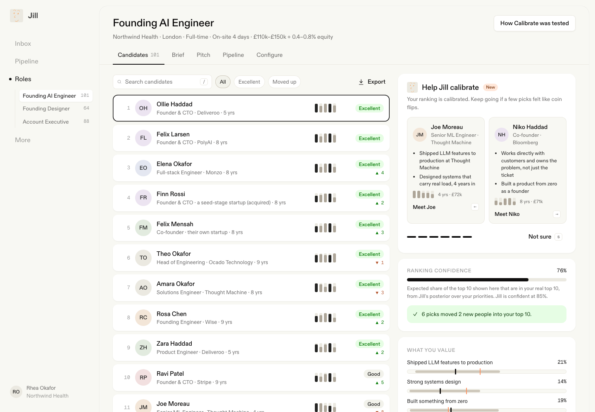

# Calibrate: Jill learns what you actually value from six picks

**Live demo:** https://mohith26.github.io/jack-jill-calibrate/

Jill ranks Jack's network against the evaluation criteria in a hiring brief, and today learns a hiring manager's real priorities slowly, from saves, passes and chat. Calibrate adds a short, deliberate step on the Candidates tab: Jill asks "who would you rather meet first?" about the pairs of candidates whose answer would teach her the most, updates a Bayesian posterior over how much the manager weighs each criterion, re-ranks the shortlist live, and shows an honest ranking-confidence meter. One click writes the learned priorities back into the brief (with version history). In a simulation of 120 hiring managers whose real priorities differ from what they wrote, **six picks raised precision@10 from 64.0% to 79.3%**, versus 71.3% for six random comparisons.



## Results (`data/results.json`, regenerated by `node scripts/build.mjs`)

| Setting | Precision@10 |
|---|---|
| Ranking by the brief's written priorities | 64.0% |
| After 6 information-gain picks | **79.3%** |
| After 6 random pairs (same pool, same model) | 71.3% |
| After 6 picks, manager twice as noisy as the model assumes | 71.2% |
| After 10 picks | 82.4% |

Confidence meter calibration (predicted expected precision@10 vs realised, 1,320 session-steps): 66.4% vs 64.9%, 75.6% vs 74.8%, 84.1% vs 84.0%, 92.6% vs 92.2%.

Sensitivity to how far managers stray from the brief (Dirichlet concentration; lower = further): concentration 2: 64.8% → 82.9% (random 72.9%); 3 (default): 64.0% → 79.3% (71.3%); 6: 76.7% → 84.2% (79.5%).

## How it works

- **Model.** Candidate i has Jill's criterion scores s<sub>i</sub> ∈ [0,1]<sup>5</sup>. The manager ranks by u<sub>i</sub> = w·s<sub>i</sub> with unknown weights w on the simplex. Prior w ~ Dirichlet(3·w<sub>0</sub>), w<sub>0</sub> = the brief's written priorities. An answer "A over B" has likelihood σ(β·w·(s<sub>A</sub> − s<sub>B</sub>)) with β = 14 (Bradley-Terry / logistic choice).
- **Posterior.** 4,000 weighted particles; when the effective sample size halves, systematic resampling plus random-walk Metropolis-Hastings moves in additive-logistic coordinates (the Dirichlet density there is ∏ w<sub>i</sub><sup>α<sub>i</sub></sup>, Jacobian included), which leaves the posterior invariant (tested).
- **Which pair to ask.** Among the 16 best candidates under the current posterior mean, the pair with the largest expected information gain about w, H(E[p]) − E[H(p)] (BALD). Never repeats a pair; "Not sure" skips it.
- **Confidence.** P(candidate in the manager's real top 10) for every candidate from posterior samples; the meter is the expected precision@10 of the list shown. Fit labels: Excellent when that probability is at least 50%.
- **Write-back.** "Update brief priorities" stores the posterior mean as a new brief version; Brief history keeps v1 and can restore it.

The app is static (`index.html`, `app.js`, `styles.css`), loads `data/role.json` (101 synthetic candidates), and runs `src/calibrate.js` in the browser, the same module the tests and the simulation use. Everything persists in localStorage (picks, brief versions, saved / intro requested / passed).

## Product surface

Jill's shell (Inbox, Pipeline, Roles with the role list, More) and the role tabs from the docs (Candidates, Brief, Pitch, Pipeline, Configure). Candidates tab with search, filters (All / Excellent / Moved up), rank movement, CSV export and the Calibrate panel; candidate view matching Jill's (pager, Pass, Request intro, Summary, Why Jill shortlisted, Goals, Criteria); Pipeline board fed by your actions; "How Calibrate was tested" report. Keyboard: ← / → pick, `s` not sure, `j`/`k`, `Enter`, `[`/`]` in the candidate view, `Esc`, `/`, `?`. "Demo answers" plays six picks as a manager who cares most about product ownership and building from zero.

## Run it

```
node scripts/build.mjs          # data/role.json + data/results.json (about 30 s)
node --test test/*.test.mjs     # 12 tests
python3 -m http.server          # open http://localhost:8000
```

Tests: Dirichlet sampler moments, sigmoid stability, posterior moves toward the truth (randomised), MH rejuvenation preserves the posterior mean, BALD choice vs brute force over all particles, information gain bounds on random posteriors (property test), top-k membership sums, ranking metrics, deterministic seeding and the salary IQR against Jack & Jill's published range, the headline study reproducing `results.json` exactly, and confidence calibration.

## Honest limitations

- **Synthetic people.** Candidate profiles and criterion scores are generated (seeded; salary expectations follow Jack & Jill's published London AI-engineer range, half expecting £70k–£120k). Real criterion scores come from Jill's evaluators and will be noisier and correlated differently.
- **Linear, stable preferences.** Real managers have must-haves, interactions and change their minds; the noisy-manager row shows the gain shrinks (71.2% at 6 picks) when answers are twice as random as modelled. A must-have would need a threshold term.
- **The concentration is an assumption.** How far real priorities stray from the written brief is unknown; the sensitivity table shows the gain at three levels. Jill's own save/pass logs could estimate it.
- **No comparison against Jill's current save/pass learning**, because its internals aren't public; the baselines are the written brief and random comparisons.
- Precision@10 is measured against the simulated manager's own ranking, not against hires.

## Prior art and novelty

Pairwise preference elicitation and Bayesian active learning are established (Bradley-Terry; BALD, Houlsby et al. 2011; preference-based active learning in recommender systems and RLHF). Jill already calibrates a role: the setup conversation asks follow-up questions and collects reference profiles ("calibration candidates"), and she learns from saves, passes, notes and chat afterwards (jackandjill.ai/docs/hiring-brief, /search-and-candidate-discovery). Other tools calibrate the same way: thumbs up / down or reviewing profiles together (Juicebox, Gem, hackajob's Archer). As far as public material shows, none asks information-optimal pairwise questions, keeps an explicit posterior over the brief's criterion weights, reports a calibrated confidence, or writes the learned weights back into the brief. That is the addition here, on top of Jill's existing calibration.

Unofficial concept demo by Mohith Gajjela. Not affiliated with Jack & Jill. Synthetic candidates and company. Jill's avatar appears in the app chrome because the demo is addressed to Jack & Jill; the ABC Diatype font is loaded from jackandjill.ai (served with `Access-Control-Allow-Origin: *`).
